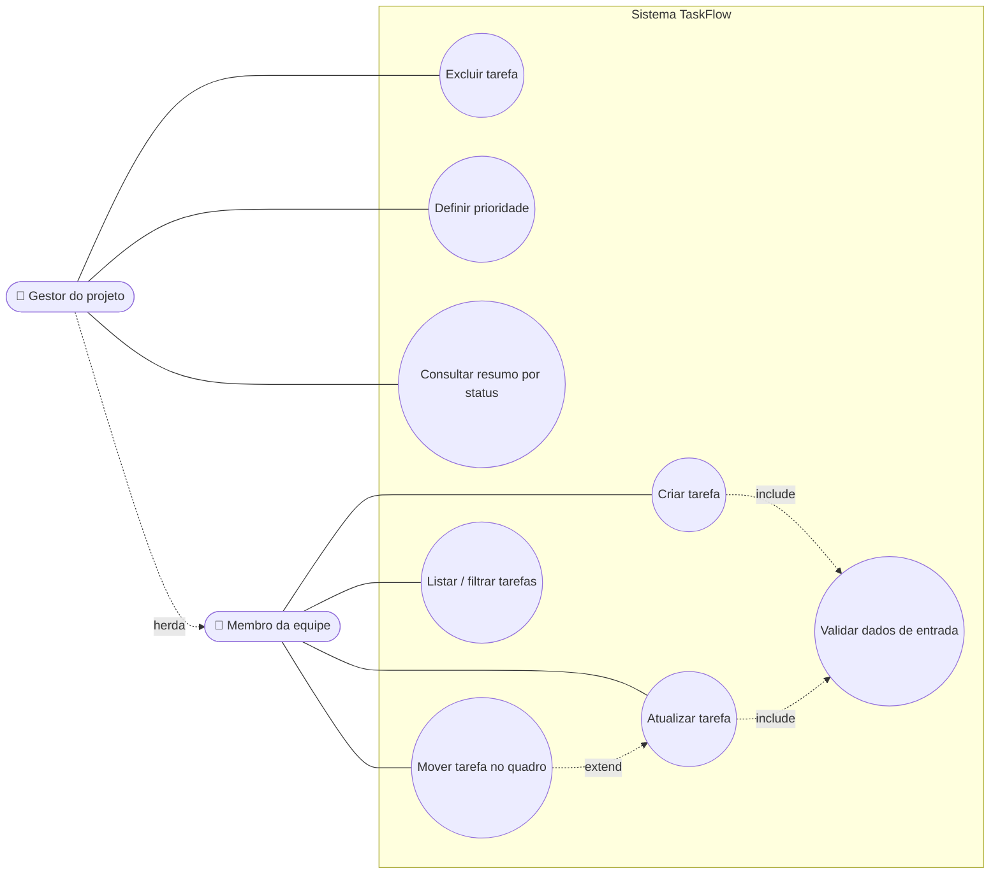
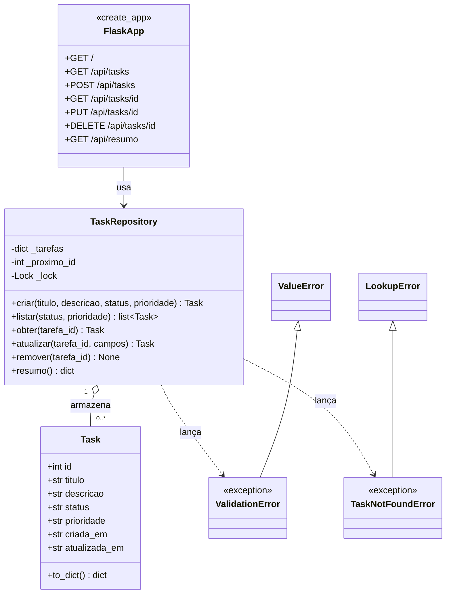

# Modelagem UML do TaskFlow

Os diagramas abaixo usam [Mermaid](https://mermaid.js.org/), que o GitHub
renderiza automaticamente.

## Diagrama de Casos de Uso

Atores:

- **Membro da equipe** (operador de logística): cria, consulta e move tarefas.
- **Gestor do projeto**: além do que o membro faz, prioriza tarefas e acompanha o resumo de desempenho.

## Diagrama de Classes

> O atributo `prioridade` e o caso de uso **Definir prioridade** foram
> incluídos na mudança de escopo descrita no [README](../README.md#gestão-de-mudanças).
